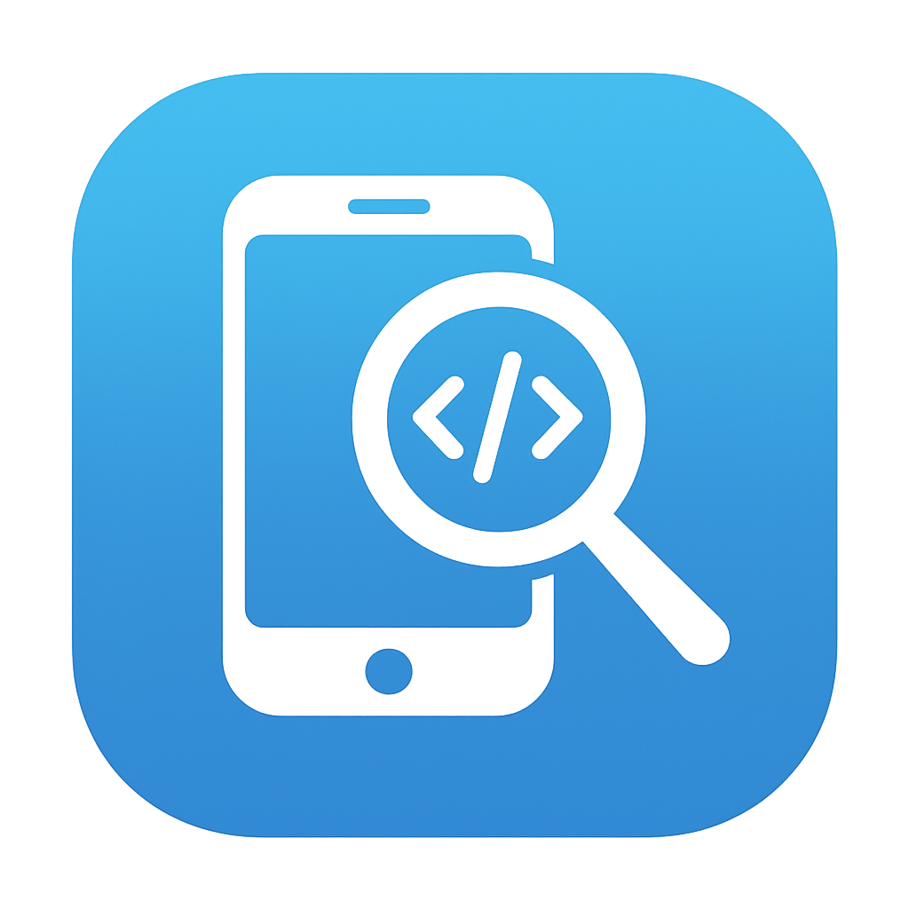
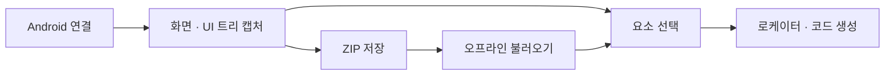

<div align="center">
  
  <h1>Appkium Inspector</h1>
  <p><strong>화면을 캡처하고, UI를 살펴보고, Appium 로케이터로 연결하세요.</strong></p>
  <p>Android UI 분석 · 오프라인 ZIP · AI 로케이터 · Windows & macOS</p>
  <p>
    
    
    <a href="LICENSE"></a>
  </p>
  <p>
    <a href="#quick-start">빠른 시작</a> ·
    <a href="#workflow">사용 흐름</a> ·
    <a href="#development">개발</a> ·
    <a href="#build">빌드</a> ·
    <a href="release-notes.md">변경 이력</a>
  </p>
</div>

---

**Appkium Inspector**는 모바일 QA 엔지니어를 위한 Electron 데스크톱 도구입니다. Android 화면과 UI 트리를 함께 캡처하고, 선택한 요소의 로케이터와 Python·Java 예제를 생성합니다. 캡처를 ZIP으로 공유하면 디바이스 없이도 분석을 이어갈 수 있습니다.

> 이전 제품명은 **GroundView**입니다. 저장소 이름과 내부 식별자(`groundview`, `com.groundview.*`)는 호환성을 위해 유지합니다.

## 주요 기능

| 기능 | 할 수 있는 일 |
| --- | --- |
| **화면 + UI 트리 캡처** | USB·무선 ADB로 스크린샷과 XML을 수집하고 Tree/List·오버레이로 탐색 |
| **Compose·팝업 분석** | 접근성 서비스로 노출되는 Compose 요소와 다중 윈도우를 함께 캡처 |
| **로케이터 생성** | Accessibility ID, Resource ID, Text, XPath, UiSelector 후보와 점수 확인 |
| **코드 예제** | Python·Java Appium 코드와 디바이스별 capabilities 생성·복사 |
| **AI 분석** | Gemini를 이용한 로케이터 제안과 이미지 OCR |
| **오프라인 ZIP** | 캡처 내보내기·불러오기, 팀원과 동일한 화면 공유 |
| **한국어·영어 UI** | 설정에서 언어 전환 |

### 지원 범위

| 대상 | 현재 상태 |
| --- | --- |
| Android | 주 개발 대상. ADB 캡처와 접근성 서비스 연동 구현 |
| Windows 10/11 x64 | NSIS 설치 프로그램·APPX(MSIX 배포용) 빌드 구성 |
| macOS Apple Silicon / Intel | 단일 코드베이스에서 DMG·ZIP 빌드 구성 |
| iOS / WDA | 연동 코드와 이식 자료 포함. 완전 지원 및 실기기 검증은 진행 과제 |
| Linux | 패키징 설정은 있으나 배포 검증 대상에 포함하지 않음 |

Compose 탐지는 대상 앱이 접근성 트리에 노출하는 정보에 따라 달라집니다. 캡처 분석과 코드 생성이 중심이며, 앱 내 실시간 탭·스와이프 자동화는 제공하지 않습니다.

<a id="quick-start"></a>
## 빠른 시작

개발 환경에는 **Node.js 18 이상**, **Python 3.10 이상**, Android 연결용 **ADB**가 필요합니다. Python은 고정 의존성과 함께 사용할 3.10–3.12 환경을 권장합니다. 최소 Node 버전은 `package.json`의 선언값입니다.

```bash
git clone https://github.com/UnitHan/Groundview_Android.git
cd Groundview_Android
```

<details open>
<summary><strong>macOS</strong></summary>

```bash
npm ci
python3 -m venv .venv
.venv/bin/python -m pip install -r requirements.txt
npm run dev
```

또는 `./setup_dev.sh`로 로컬 환경을 준비한 뒤 `npm run dev`를 실행합니다. ADB는 앱의 환경 설정에서 탐지·다운로드하거나 기존 Android SDK의 `platform-tools/adb`를 지정할 수 있습니다.

</details>

<details>
<summary><strong>Windows · PowerShell</strong></summary>

```powershell
npm ci
py -3.10 -m venv .venv
.\.venv\Scripts\python.exe -m pip install -r requirements.txt
npm run dev
```

다른 Python 버전을 설치했다면 `py -3.10`을 해당 버전으로 바꾸세요. 가상환경 활성화 없이 실행할 수 있으며, 백엔드 런처가 `.venv`를 찾습니다.

</details>

개발 서버는 렌더러 **3000**, Python API **5005** 포트를 사용합니다. ADB·파일 다이얼로그 등은 Electron 창에서 동작합니다.

<a id="workflow"></a>
## 사용 흐름



1. **연결** — USB 디버깅을 켜고 PC 연결을 허용한 뒤 ADB 경로와 디바이스를 선택합니다.
2. **캡처** — Capture를 실행합니다. 접근성 서비스가 설치되면 폰 설정에서 **Appkium Inspector Service**를 한 번 활성화합니다.
3. **분석** — 화면의 요소 또는 Tree/List 항목을 선택해 속성·로케이터 후보를 확인합니다.
4. **활용** — Python·Java 코드를 복사하거나 ZIP으로 저장합니다. 기존 캡처는 **Load ZIP File**로 불러옵니다.
5. **AI 사용(선택)** — 설정에 Gemini API 키를 등록하고 AI 로케이터 또는 OCR을 실행합니다.

AI 기능에는 네트워크와 사용자 API 키가 필요합니다. 요청에 따라 스크린샷·UI 정보가 Gemini API로 전송됩니다. 로컬 캡처 분석과 기본 로케이터 생성은 Gemini 없이 사용할 수 있습니다.

<a id="development"></a>
## 개발 및 검사

```bash
npm run check        # TypeScript → 단위 테스트 → 프론트엔드 빌드
npm run typecheck    # 타입 검사
npm test             # core + desktop 단위 테스트
npm run build        # dist/renderer 생성
```

| 명령 | 용도 |
| --- | --- |
| `npm run dev` | Python API + Vite + Electron 실행 |
| `npm run dev:py` | Python API만 실행 |
| `npm run dev:renderer` | Vite 렌더러만 실행 |
| `npm run dev:app` | Vite + Electron 실행 |

현재 자동 테스트는 로케이터와 오버레이 유틸리티의 **6개 테스트**입니다. 디바이스 캡처·Gemini API·설치 프로그램은 별도 수동 검증이 필요합니다. 로컬에 존재하는 별도 프로젝트 `Groundview_iOS/`는 이 저장소의 테스트 대상에서 제외합니다.

### 프로젝트 구조

```text
app/                   Electron 메인·preload, ADB/WDA 서비스
desktop/              React + TypeScript UI (Vite)
backend/              FastAPI, Gemini OCR·로케이터 API
core/                 공유 로케이터 생성·점수화
groundview-service/   Android 접근성 서비스 (Kotlin)
resources/            배포용 APK·스토어 이미지
scripts/              개발 런처·Python/ADB 번들링
build/                설치 프로그램 리소스·macOS entitlements
docs/                 운영 가이드·과거 분석/배포 기록
android/              Android 모듈 분리용 초기 코드
ios/                  iOS 이식용 코드·자료
```

**주요 스택:** Electron 28 · React 18 · TypeScript 5 · Vite 5 · FastAPI · Kotlin

<a id="build"></a>
## 패키징

대상 운영체제에서 실행합니다. 결과물은 `dist/electron/`에 생성됩니다.

| 환경 | 명령 | 결과 |
| --- | --- | --- |
| macOS | `npm run dist:mac` | arm64·x64 DMG / ZIP |
| Windows | `npm run dist:win` | 설정된 Windows 대상: NSIS / APPX / ZIP |
| Windows Store용 | `npm run dist:msix` | Python·ADB 번들을 포함한 APPX |

Windows용 Python 번들은 빌드 스크립트로 생성합니다. macOS 패키지는 시스템 Python을 바탕으로 앱 전용 가상환경을 만들고 의존성을 설치합니다. 서명·공증 절차와 설치 후 점검 항목은 [macOS 가이드](docs/MACOS_PORT_GUIDE.md)를 참고하세요.

Android 서비스 소스를 수정할 때만 APK를 다시 빌드하면 됩니다. [서비스 빌드 안내](groundview-service/README.md)를 참고하세요.

## 문서와 현재 상태

- [프로젝트 상태 및 남은 검증](docs/STATUS.md)
- [릴리스 노트](release-notes.md)
- [macOS 개발·빌드·배포](docs/MACOS_PORT_GUIDE.md)
- [앱 제거 및 데이터 정리](UNINSTALL.md)
- [Windows Store 대응 기록](docs/STORE_RELEASE_LOG.md) — 과거 작업 기록
- [iOS 이식 가이드](docs/iOS_MIGRATION_GUIDE.md) — 참고 자료

**소스 버전과 실제 배포 상태는 별개입니다.** 저장소의 빌드 설정·과거 산출물만으로 스토어 승인이나 최신 설치 파일 게시 여부를 보장하지 않습니다.

## 라이선스

소스 코드는 [MIT License](LICENSE)를 따릅니다. 설치 프로그램에 포함되는 이용약관은 [LICENSE.txt](LICENSE.txt), 외부 구성요소 고지는 [THIRD-PARTY-NOTICES.md](THIRD-PARTY-NOTICES.md)를 참고하세요.

<div align="center"><sub>Built by QA Bulls · Formerly GroundView</sub></div>
